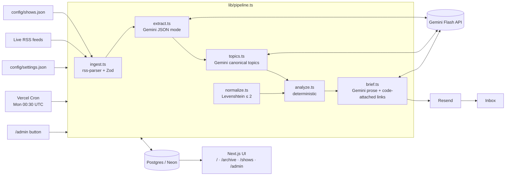

# Podcast Ecosystem Radar

A weekly intelligence brief for **Aditya**, who hosts a podcast for Indian startup founders. Every Monday before 7:00 AM IST, the system reads the latest episodes of 10 Indian startup, VC, finance and creator podcasts. It then emails a skimmable brief that answers three questions:

1. **Guests:** who appeared on two or more monitored shows in the last 30 days? These founders are doing media rounds, so they are the easiest to book now.
2. **Topics:** which themes did two or more shows cover in the last 7 days? Ride them or counter-program them.
3. **Sponsors and brands:** which brands are sponsoring or running ad reads? This feeds the sponsor pitch list.

Every item links back to the source episodes, so each claim can be traced.

- **Live app:** see the Vercel URL in the repo description
- **Components Map:** [`docs/COMPONENTS_MAP.md`](docs/COMPONENTS_MAP.md) and [`docs/components_map.png`](docs/components_map.png)

> **AI note:** every LLM call in this app uses **Google Gemini Flash** through the official `@google/genai` SDK (`lib/gemini.ts`). The model comes from `GEMINI_MODEL` and defaults to `gemini-3.5-flash-lite`, verified against the Gemini API's model list at build time. No other LLM provider is imported or called.

## Architecture



**Stack:** Next.js 16 (App Router, TypeScript strict) on Vercel · Postgres on Neon (`postgres` driver) · Resend · Gemini Flash (`@google/genai`) · Tailwind CSS v4 · Vitest.

### Pipeline steps

| Step | File | What happens |
| --- | --- | --- |
| Ingest | `lib/ingest.ts` | Fetches every enabled feed and Zod-validates each item. Keeps episodes from the last 35 days, dedupes by guid and inserts with `ON CONFLICT DO NOTHING`, so re-runs are idempotent. Stores title, date, show notes, link and transcript URL (if the feed has `<podcast:transcript>`). |
| Extract | `lib/extract.ts` | For each new episode, Gemini Flash (JSON mode + response schema) returns `guests[{name, role_or_company}]`, `topics` (2–5 labels) and `brands[{name, relationship: sponsor/ad_read/mentioned/product_placement}]`. The prompt requires empty arrays over guesses. Output is Zod-validated. Episodes are batched several per call, and calls are rate-limited and retried with exponential backoff on 429/5xx. The show's own brands (`self_brands`) and podcast platforms are dropped. |
| Canonicalize topics | `lib/topics.ts` | One Gemini call receives the week's topic labels and returns a canonical mapping, so "fundraising" and "raising funds" collapse together. The mapping is stored in `topic_canon`. |
| Normalize | `lib/normalize.ts` | Guest names are lowercased, with honorifics, punctuation and diacritics stripped and whitespace collapsed. Brand names also lose decorative suffixes ("Zepto app" → "zepto"). Near-duplicates are merged by Levenshtein distance (single-link clustering): up to 2 edits for names of 8+ characters, 1 edit for 5–7 characters, and an exact match below that. Merged names must also share a first letter, so "Intel" and "Airtel", which are 2 edits apart, stay separate. |
| Analyze | `lib/analyze.ts` | Deterministic code, no LLM (see below). |
| Brief | `lib/brief.ts` | Gemini Flash receives the analysis JSON with ref ids (`G1`, `T3`, `B2`). It writes the 3-sentence "This week in one line" and an insight and action for 3–7 items per section. Any ref not in the analysis is discarded. Shows and episode links are attached by code, so citations can't be invented. If Gemini is unavailable, a deterministic fallback writes the brief. The result is stored as Markdown, email HTML and structured JSON. |
| Deliver | `lib/email.ts`, `app/api/cron/weekly` | Vercel Cron calls `/api/cron/weekly` at `30 0 * * 1` (06:00 IST Monday) with `Authorization: Bearer $CRON_SECRET`. The brief is saved to `briefs` keyed by week and emailed through Resend. |

### How the three analyses are computed

- **`guest_overlap`:** take every guest appearance in episodes published in the last `guest_window_days` (30). Cluster the names (normalize, then length-scaled Levenshtein ≤ 2) and keep clusters that appear on **≥ 2 distinct shows**. Several episodes of the same show don't count. Results are ranked by number of shows, then recency, and each includes its shows and episode URLs.
- **`topic_clusters`:** take every episode in the last `topic_window_days` (7) and map each topic label through the canonical mapping. Keep canonical topics covered by **≥ 2 distinct shows**, ranked by show count, then episode count.
- **`brand_signals`:** take brand mentions in the last `brand_window_days` (30) and cluster brand names. Keep brands with **at least one `sponsor` or `ad_read`**, ranked by number of distinct shows, then shows with paid placements. Each episode reference carries its relationship type.

All three are pure functions with unit tests (`tests/analyze.test.ts`, `tests/normalize.test.ts`).

### Reliability

- Each Vercel function sets `maxDuration = 300`. The pipeline gives extraction a time budget and leaves the rest for the next run. A **daily** cron (`/api/cron/ingest`, 18:30 UTC) ingests and extracts every day, so Monday's run only handles a small backlog.
- Every run is logged to the `runs` table (shows OK/failed, episodes added, extraction counts, Gemini calls and retries, email status) and shown on `/admin`.
- Feed failures are isolated per show and recorded on `/shows`. Episodes that fail extraction three times are skipped.

## Monitored shows

Edit **`config/shows.json`** to change shows, with no code changes:

```json
{
  "id": "neon-show",                          // unique, kebab-case
  "name": "The Neon Show",
  "rss_url": "https://rss.buzzsprout.com/1601695.rss",
  "enabled": true,                            // false = keep in config but skip
  "self_brands": ["Neon Fund", "The Neon Show"] // the show's own company/fund: not counted as sponsors
}
```

To find a feed URL, use the iTunes Search API, e.g. `https://itunes.apple.com/search?term=founder%20thesis&entity=podcast&country=IN`, and copy `feedUrl`. Check it with `npm run verify-feeds`, which fetches every feed in the config and reports recent episode counts. Commit and push; Vercel redeploys and the next run uses the new list. Windows, recipients and Gemini rate limits live in **`config/settings.json`**.

Current shows (all verified to have episodes in the last 30 days): The Neon Show, Founder Thesis, Prime Venture Partners Podcast, Figuring Out with Raj Shamani, Paisa Vaisa, Moneycontrol Podcast, The Ranveer Show (Hindi), Varun Mayya, Subtext by Zerodha and The Daily Brief by Zerodha.

## Setup

```bash
npm install
cp .env.example .env.local   # fill in the values
git config core.hooksPath .githooks   # pre-commit secret scan
```

| Variable | Purpose |
| --- | --- |
| `GEMINI_API_KEY` | Google AI Studio key |
| `GEMINI_MODEL` | Gemini Flash model id (default `gemini-3.5-flash-lite`) |
| `DATABASE_URL` | Postgres connection string (Neon pooled URL in production) |
| `RESEND_API_KEY` | Resend API key |
| `CRON_SECRET` | Shared secret Vercel Cron sends as a Bearer token |
| `ADMIN_SECRET` | Password for the `/admin` run button |
| `EMAIL_FROM` | Sender, e.g. `Podcast Radar <onboarding@resend.dev>` |
| `BRIEF_RECIPIENTS` | Optional comma-separated override of `settings.json` recipients |

Tables are created automatically on first use.

```bash
npm run pipeline              # ingest + extract + brief locally (no email)
npm run pipeline -- --email   # same, and send the email
npm run dev                   # http://localhost:3000
npm test                      # Vitest unit tests
```

## Triggering a manual run

- **Web:** open `/admin`, enter `ADMIN_SECRET` and click **Run ingestion now** (optionally tick "Also email").
- **API:** `curl -X POST https://<app>/api/admin/run -H "x-admin-secret: $ADMIN_SECRET" -H 'content-type: application/json' -d '{"email":false}'`
- **The weekly cron itself:** `curl https://<app>/api/cron/weekly -H "Authorization: Bearer $CRON_SECRET"`
- **CLI:** `npm run pipeline` (uses `DATABASE_URL` from `.env.local`).

## Secrets hygiene

`.env*` is git-ignored (except `.env.example`). The tracked `.githooks/pre-commit` runs `scripts/check-secrets.sh --staged`, which aborts a commit if any staged file contains a value from `.env.local`. Run `scripts/check-secrets.sh` to scan every tracked file.

## Known limitations

- **Show notes may not name guests.** Extraction only sees RSS titles and show notes; many feeds describe the episode without naming the guest, or name them only in the audio. Guest overlap is therefore a lower bound. Transcripts are used only where a feed publishes `<podcast:transcript>`, and most Indian podcast feeds don't yet.
- **Sponsor detection depends on the notes.** Ad reads spoken in the audio but missing from the notes are invisible.
- **Free-tier Gemini quotas.** On the free tier, requests per minute and per day are limited. That's why extraction batches several episodes per call, throttles requests and runs daily. Larger show lists may need a paid tier or a lower `episodes_per_call`.
- **Resend sandbox.** Until a sending domain is verified in Resend, email can only go to the Resend account owner's address. `BRIEF_RECIPIENTS` handles this.
- **Topic canonicalization uses an LLM**, so labels can shift slightly week to week. Previously used canonical labels are passed back in to keep them stable.
- **Show list changes need a redeploy.** Config is bundled at build time, and every push to `main` redeploys automatically.
