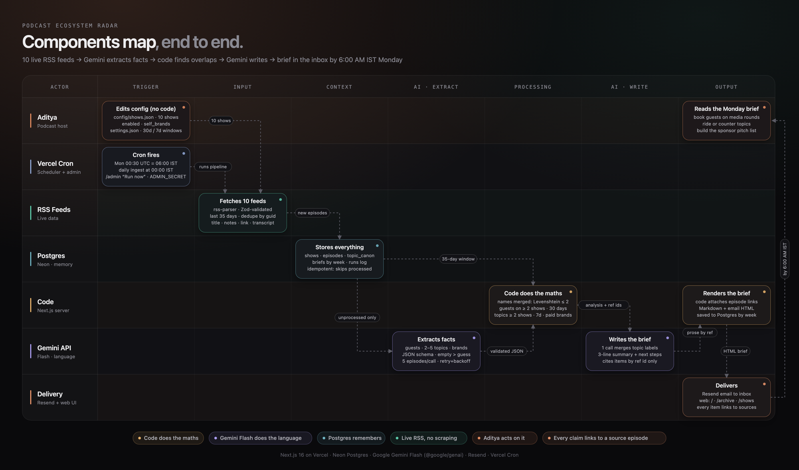
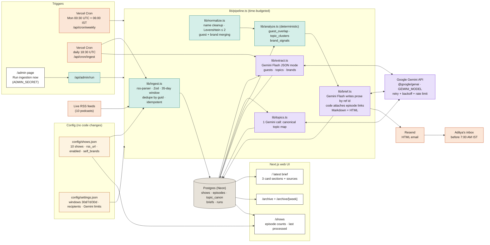

# Components Map: Podcast Ecosystem Radar

Rendered image: [`components_map.png`](./components_map.png), a dark swimlane view (actors as rows, stages as columns) styled to match the web UI. Vector source: [`components_map.svg`](./components_map.svg), generated by `scripts/gen-components-map.py`. A Mermaid version of the same flow is at the bottom of this page.

## Components

| Component | File(s) | Role |
| --- | --- | --- |
| Show config | `config/shows.json` | The monitored shows (`id`, `name`, `rss_url`, `enabled`, `self_brands`). Edit to change shows; no code changes. |
| Run settings | `config/settings.json` | Guest/topic/brand windows (30/7/30 days), ingest window (35 days), recipients, Gemini rate limits. |
| RSS ingestion | `lib/ingest.ts` | Fetches each enabled feed with `rss-parser`, Zod-validates items, keeps the last 35 days, dedupes by guid, inserts idempotently. |
| Gemini extraction | `lib/extract.ts`, `lib/gemini.ts` | Gemini Flash in JSON mode with a response schema returns `guests`, `topics`, `brands` per episode (batched, several episodes per call). Zod-validated; retries 429/5xx with exponential backoff. |
| Topic canonicalization | `lib/topics.ts` | One Gemini call per run maps the week's raw topic labels to canonical topics. |
| Normalization | `lib/normalize.ts` | Deterministic name cleanup plus Levenshtein ≤ 2 clustering for guests and brands. |
| Analysis | `lib/analyze.ts` | Deterministic `guest_overlap`, `topic_clusters`, `brand_signals`, each with source episode links. |
| Brief generation | `lib/brief.ts` | Gemini Flash writes the headline and per-item insight and action, referencing analysis items by id. Code attaches shows and links, then renders Markdown and email HTML. |
| Orchestrator | `lib/pipeline.ts` | Ingest → extract → canonicalize → analyze → brief → email, within a time budget. Logs every run to `runs`. |
| Postgres | `lib/db.ts` | Tables `shows`, `episodes`, `topic_canon`, `briefs`, `runs` (Neon in production). |
| Resend delivery | `lib/email.ts` | Sends the HTML brief to the recipients. |
| Vercel Cron | `vercel.json`, `app/api/cron/weekly`, `app/api/cron/ingest` | Weekly brief every Monday 00:30 UTC (06:00 IST); daily ingest and extraction at 18:30 UTC. Both protected by `CRON_SECRET`. |
| Web UI | `app/page.tsx`, `app/archive`, `app/shows` | Latest brief as cards with sources, archive of past briefs, monitored shows with counts. |
| Admin trigger | `app/admin`, `app/api/admin/run` | "Run ingestion now" button protected by `ADMIN_SECRET`. |

## Diagram source

